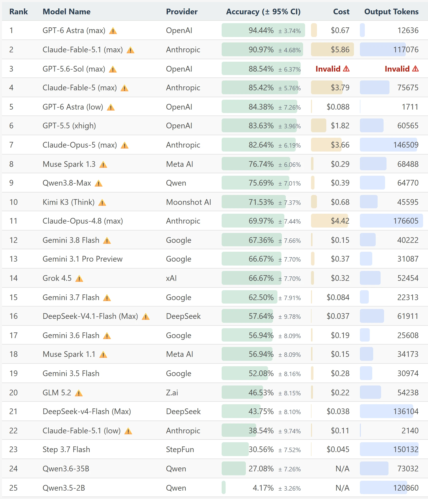
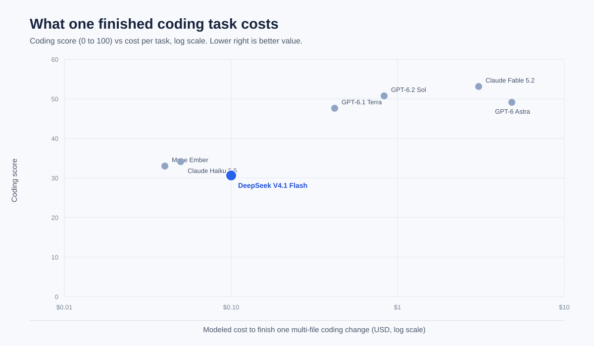

# Cost Per Effective Token: What a 1M Context Window Actually Costs

- Summary: A 1M context window is a capacity limit, not a bill. MathArena and cost-per-task data show why tokens per finished job, not list price, decide what you pay.
- Date: 2026-11-27
- Byline: By Cameron Voss
- Route: /articles/cost-per-effective-token-1m-context (registered in src/lib/november-articles.ts)
- Language: en (Chinese twin in article.zh.md)
- Preview: preview/cost-per-effective-token-1m-context.en.html

## TL;DR

- A 1M context window is a capacity limit, not a bill. You pay for tokens a task consumes, not tokens it could hold.
- On the MathArena June 2026 set, two models listed at the same $10 / $50 per 1M tokens cost $0.67 and $5.86 per question, an 8.7x gap driven by 12,636 versus 117,076 output tokens.
- DeepSeek-V4.1-Flash (Max) scored 57.64% at $0.037 per question with 61,911 output tokens on that set.
- On a modeled multi-file coding task, DeepSeek V4.1 Flash costs $0.10 per task; 57 models span $0.03 to $4.85 for the same job.
- The lever is tokens per finished task. Keep the prompt prefix stable, cap output, and measure on your own workload.

## Body

### What does a 1M context window actually cost?

Nothing by itself. The window tells you how much text the model can hold at once, and the bill follows the tokens a task actually pushes through the meter. On DeepSeek's first-party API, a full million tokens of fresh input would come to $0.14. If every one of those tokens hit the cache, the same input would come to $0.028. Output is metered on its own at $0.28 per million.

Real jobs rarely fill the window. A coding agent re-reads its system prompt and tool definitions on every turn, and when that prefix stays stable the tokens bill at the cache-hit rate. The modeled multi-file task in the tracker below assumes 1.5M input tokens with 90% served from cache, plus 40K output tokens in a single pass. Most of that bill comes from output and from the tenth of input that misses the cache, not from the size of the window. You can buy a bigger window, but you cannot get a discount on tokens you never send.

### Why do two models with the same list price bill differently?

The rate is per token, and each model burns a different number of tokens to finish the same question.

MathArena's June 2026 set makes this easy to see. GPT-6 Astra (max) and Claude-Fable-5.1 (max) both sit at $10 per million input tokens and $50 per million output tokens. Astra scored 94.42% per question at a cost of $0.67 and wrote 12,636 output tokens. Fable 5.1 scored 90.97% at $5.86 and wrote 117,076 output tokens. That is 8.7x the spend for a slightly lower score, and the longer answers explain nearly all of it.

DeepSeek-V4.1-Flash (Max) scored 57.64% at $0.037 per question with 61,911 output tokens on the same set. The older DeepSeek-v4-Flash (Max) scored 43.75% at $0.038 with 136,104 tokens. The two DeepSeek rows cost almost the same, yet one writes less than half the output and scores higher. That difference is what an effective-token number is meant to catch.

### How many tokens does a finished task actually burn?

The useful number is the cost of one completed job, not the cost of one prompt.

The cost-per-task tracker models a multi-file coding change as 1.5M input tokens (90% cached), 40K output tokens, one pass. It prices 57 models on that identical job. Hy4 flash finishes at $0.03 and GPT-6 Astra at $4.85, a 188x spread for the same work. DeepSeek V4.1 Flash comes in at $0.10 with a coding score of 30.6. GPT-6.1 Terra is $0.42 for a score of 47.6. Claude Fable 5.2 is $3.07 for 53.1.

Task shape moves the ranking. DeepSeek V4.1 Flash is $0.02 for a one-file edit, $0.10 for a multi-file change and $0.20 for an agentic run. Those shifts never appear on a per-token rate card, so a rate card alone will not tell you what a workflow costs.

| Model | One-file edit | Multi-file change | Agentic task | Coding score |
| --- | --- | --- | --- | --- |
| DeepSeek V4.1 Flash | $0.02 | $0.10 | $0.20 | 30.6 |
| GPT-6.1 Terra | $0.08 | $0.42 | $0.83 | 47.6 |
| Claude Fable 5.2 | $0.58 | $3.07 | $6.14 | 53.1 |
| GPT-6 Astra | $0.82 | $4.85 | $9.70 | 49.1 |

To see what the current rates look like on this site, the [pricing page](https://deepseekv4flash.com/pricing) lists the plans and allowances.

### How do you compare models without a benchmark degree?

Put cost, quality and speed on the same plane and pick a point you can live with.

That plane is the cost-intelligence frontier. For one task type, performance, speed and cost per finished job form a boundary you cannot improve on all at once, and every model choice sits somewhere on it. You can fix the spend per task and see which model scores highest, or fix the score and see which model charges least. A model at $4.85 and a model at $0.10 can land in the same accuracy band. Once you plot every candidate on cost against quality, any point well below the line can be dropped, since another model there is both cheaper and stronger.

The frontier belongs to the task, not the product. A model on the frontier for complex visual reasoning can sit far from it on ticket sorting. Draw it per task type instead of once per model family.

### How do you cut the cost per effective token?

Look at what the meter sees before you swap the model on the API call.

- Keep the system prompt and tool schema byte-for-byte stable. Cache hits on DeepSeek bill at $0.028 per million instead of $0.14, which cuts repeated input by 5x.
- Cap output length. Output runs at $0.28 per million, ten times the cache-hit input rate, and verbose reasoning lands on the invoice.
- Count retries. If a job needs 1.5 attempts on average to pass, the effective cost is 1.5x the single-pass figure.
- Measure all of it on your own tasks for 4 to 8 weeks, because model releases move the frontier faster than a yearly contract can follow.

Data notes: MathArena ArXivMath June 2026 set (checked 23 September 2026); Capital & Compute cost-per-task tracker (rates as of 21 November 2026); AI Master cost-intelligence frontier (29 October 2026). Figures come from third-party evaluations; your bill depends on your own workload.
