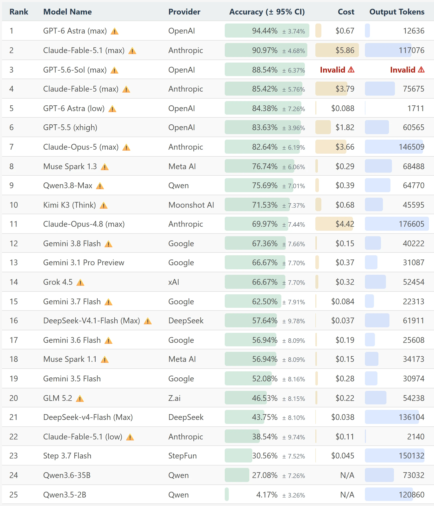
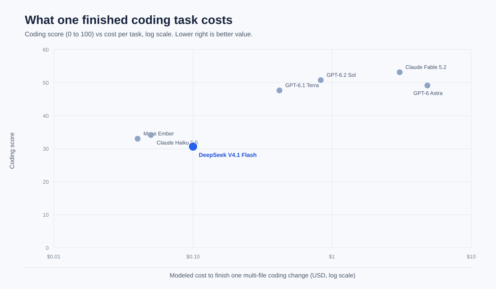

# 有效 Token 成本：1M 上下文窗口到底要花多少钱

- Summary: 1M 上下文是容量上限，不是账单。MathArena 与每任务成本数据说明：决定你花多少钱的，是完成一件任务用掉的 token，而不是牌价。
- Date: 2026-11-27
- Byline: By Cameron Voss
- Route: /articles/cost-per-effective-token-1m-context（正式站点为英文；中文仅归档）
- Language: zh（英文版为 article.md）

## TL;DR

- 1M 上下文是容量上限，不是账单。你付的是任务真正消耗的 token，不是它能装下的 token。
- MathArena 2026 年 6 月那批题里，两款牌价同为每 1M token $10／$50 的模型，每题花 $0.67 和 $5.86，差 8.7 倍；输出 token 分别是 12,636 和 117,076。
- 同一批题中，DeepSeek-V4.1-Flash（Max）正确率 57.64%，每题 $0.037，输出 61,911 token。
- 在模拟的多文件改写任务上，DeepSeek V4.1 Flash 每任务 $0.10；57 款模型在同一任务上的价格从 $0.03 到 $4.85。
- 真正的杠杆是每完成一件任务用掉多少 token。把提示前缀固定住、限制输出长度、用自己的任务去测。

## Body

### 1M 上下文窗口到底花多少钱？

它本身不花钱。窗口只是告诉你模型一次能装下多少文本，账单跟的是任务真正推进计费器的那些 token。按 DeepSeek 一方 API 的价格，满打满算 100 万全新输入 token 是 $0.14；如果这些 token 全部命中缓存，同样的输入是 $0.028。输出单独计费，每百万 $0.28。

真实任务很少把窗口填满。编码 agent 每一轮都会重读系统提示和工具定义，只要这段前缀稳定，这些 token 就按命中缓存的价格算。下面这张表用的多文件任务模型是：150 万输入 token，其中 90% 来自缓存，加上 4 万输出 token，一次跑完。账单里占大头的是输出，以及那 10% 没命中缓存的输入，跟窗口大小关系不大。窗口可以买得更大，但你省不下那些根本没发出去的 token。

### 牌价一样的两款模型，为什么账单差这么多？

因为单价是按 token 算的，而每款模型完成同一道题烧掉的 token 数不一样。

MathArena 2026 年 6 月那批题把这件事摆得很清楚。GPT-6 Astra（max）和 Claude-Fable-5.1（max）的输入单价都是每百万 $10，输出都是每百万 $50。Astra 正确率 94.42%，每题 $0.67，写了 12,636 个输出 token。Fable 5.1 正确率 90.97%，每题 $5.86，写了 117,076 个输出 token。多花 8.7 倍的钱，正确率反而低一点，而差距几乎全来自更长的回答。

同一批题里，DeepSeek-V4.1-Flash（Max）正确率 57.64%，每题 $0.037，输出 61,911 token。更早的 DeepSeek-v4-Flash（Max）正确率 43.75%，每题 $0.038，输出 136,104 token。两行 DeepSeek 花的钱几乎一样，但其中一个输出还不到一半，正确率却更高。这个差别，正是"有效 token"这个指标想抓住的东西。

### 完成一件任务，到底烧掉多少 token？

有用的数字是一件活干完要花多少钱，而不是一条提示要花多少钱。

每任务成本追踪器把一次多文件代码改写建模为：150 万输入 token（90% 来自缓存）、4 万输出 token、一次跑完。它用同一份活给 57 款模型定价。Hy4 flash 花 $0.03 就干完，GPT-6 Astra 要 $4.85，同一件活差了 188 倍。DeepSeek V4.1 Flash 是 $0.10，编码得分 30.6。GPT-6.1 Terra 是 $0.42，得分 47.6。Claude Fable 5.2 是 $3.07，得分 53.1。

任务形态一变，排名也跟着变。DeepSeek V4.1 Flash 改单个文件是 $0.02，改多个文件是 $0.10，跑 agent 任务是 $0.20。这些变化在任何按 token 计费的价格表上都看不到，所以光看价格表算不出一条工作流到底要花多少。

| 模型 | 单文件修改 | 多文件修改 | Agent 任务 | 编码得分 |
| --- | --- | --- | --- | --- |
| DeepSeek V4.1 Flash | $0.02 | $0.10 | $0.20 | 30.6 |
| GPT-6.1 Terra | $0.08 | $0.42 | $0.83 | 47.6 |
| Claude Fable 5.2 | $0.58 | $3.07 | $6.14 | 53.1 |
| GPT-6 Astra | $0.82 | $4.85 | $9.70 | 49.1 |

想看看本站当前的价格和额度，[价格页面](https://deepseekv4flash.com/pricing)列得很清楚。

### 没有评测背景，怎么比较模型？

把成本、质量和速度放在同一张图上，挑一个你能接受的点。

这张图就是成本-智能前沿。对某一类任务来说，性能、速度和每件任务的成本会形成一条边界，你没法同时把这三项都推到最好，每个模型选择都落在这条边界的某个位置上。你可以固定每任务的预算，看谁分最高；也可以固定分数，看谁最便宜。$4.85 的模型和 $0.10 的模型，可能落在同一个准确率区间里。把所有候选按成本和质量画出来，明显低于边界线的那些点可以直接划掉，因为那个位置上有更便宜、也更强的模型。

前沿是按任务划的，不是按产品划的。一个模型在复杂视觉推理上站在前沿，放到工单分类上可能就离得很远。所以按任务类型各画一张，别按模型家族画一次就完事。

### 怎么把每有效 token 的成本压下来？

在换模型之前，先看看计费器到底看到了什么。

- 把系统提示和工具定义保持逐字节稳定。DeepSeek 命中缓存的输入是每百万 $0.028，而不是 $0.14，重复输入直接省 5 倍。
- 限制输出长度。输出是每百万 $0.28，是命中缓存输入的十倍，啰嗦的推理会原样出现在账单上。
- 把重试算进去。如果一件任务平均要试 1.5 次才能过，实际成本就是单次成本的 1.5 倍。
- 用自己的任务连续测 4 到 8 周。模型更新推着前沿移动的速度，比你签年度合同的速度快。

数据说明：MathArena ArXivMath 2026 年 6 月题目（2026 年 9 月 23 日查阅）；Capital & Compute 每任务成本追踪器（价格截至 2026 年 11 月 21 日）；AI Master 成本-智能前沿（2026 年 10 月 29 日）。数字来自第三方评测，你的账单取决于自己的任务。
