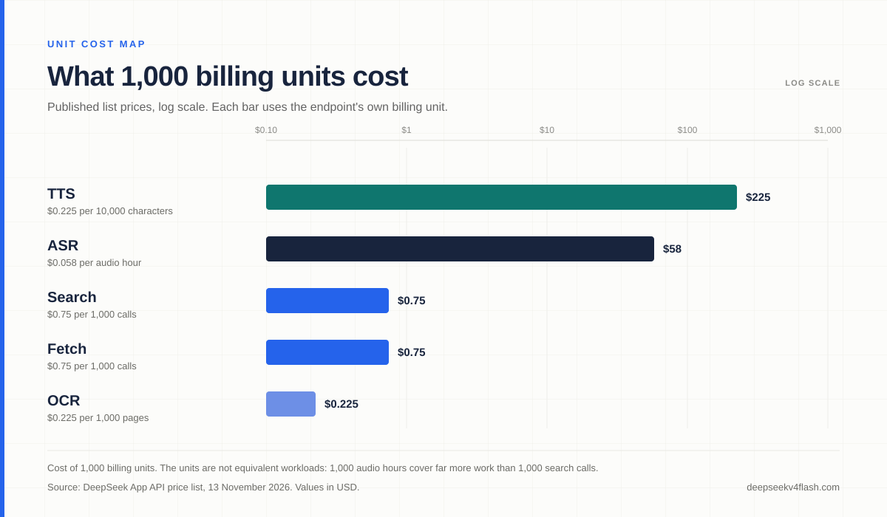
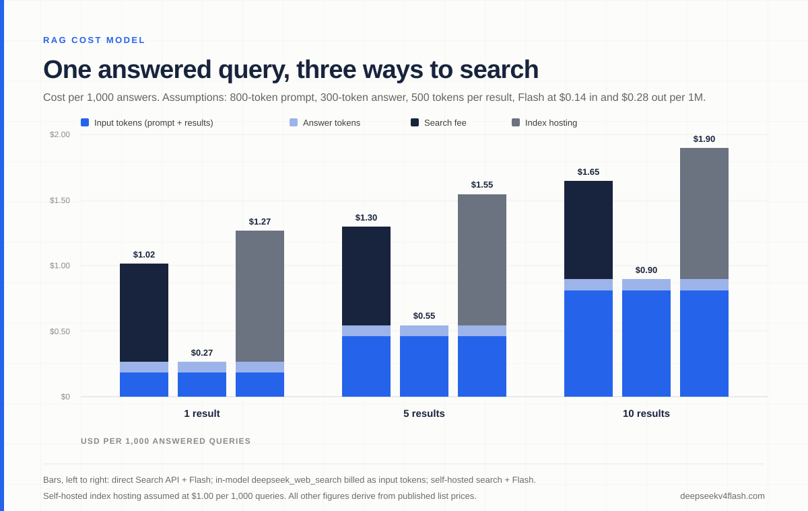
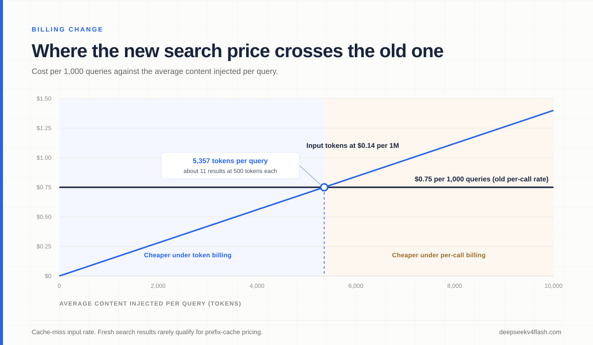

# DeepSeek Search API Pricing Shift: It’s Not Simply a Price Cut

- Summary: DeepSeek turned the chat app's tools into API endpoints on 13 November, then moved server-side search to input-token billing at the end of the month. This is what each unit costs, what a RAG answer costs under three architectures, and where the old and new search prices cross.
- Date: 2026-11-26
- Byline: By Cameron Voss
- Route: /articles/deepseek-app-api-suite-unit-costs (preview only; not yet registered in src/lib)
- Language: en (Chinese twin in article.zh.md)
- Preview: preview/deepseek-app-api-suite-unit-costs.en.html

## TL;DR

- On 13 November, DeepSeek exposed the app stack as API endpoints: Search, Fetch, OCR, ASR, TTS, file input and safety checks.
- List prices: Search and Fetch $0.75 per 1,000 calls, OCR $0.225 per 1,000 pages, ASR $0.058 per audio hour, TTS $0.225 per 10,000 characters.
- At the end of November, server-side search moves from a per-call fee to input-token billing. A 500-token result costs about $0.00007, close to a tenth of the old fee per query.
- The two search prices cross at roughly 5,400 tokens of injected results per query, about 11 results at 500 tokens each.
- In a worked example, an in-model search answer costs $0.27 to $0.90 per 1,000 answers; calling the standalone Search API costs $1.02 to $1.65.

## Body

On 13 November, DeepSeek exposed the capabilities behind its chat app as API endpoints. Web search, URL reading, file input, safety screening, OCR, speech recognition and speech synthesis became things you can call directly, or switch on inside a model request. At the end of the month, the company also changes how server-side search is billed: from a flat fee per search to the input tokens that the search results occupy.

Both changes are easy to describe. The second one is easy to misread as a price cut. It is not. It changes what you meter, and the bill moves in both directions depending on how much text your searches bring back.

### Five capabilities, five billing units

The price list is short. Search costs $0.75 per 1,000 calls. Fetch, which reads a URL and returns its content, costs the same. OCR and file parsing cost $0.225 per 1,000 pages. Speech recognition costs $0.058 per audio hour. Speech synthesis costs $0.225 per 10,000 characters.

The units are the first thing to notice. Only Search and Fetch are priced per call. OCR is priced per page, ASR per hour and TTS per character block. Comparing the headline numbers without converting them is how budgets go wrong.

*The log axis keeps a 1,000x spread on one chart: $0.225 at the low end, $225 at the high end.*

Converted to 1,000 billing units, the spread runs from $0.225 for 1,000 OCR pages to $225 for 1,000 TTS blocks. Search and Fetch sit at $0.75. The voice endpoints look cheap per unit and become large line items once volume is measured in hours and characters: 1,000 hours of audio is $58, and a product that synthesizes 1 million characters pays $22.50. Neither number is alarming on its own. Both are easy to miss when the invoice arrives.

### What one retrieved answer costs

A unit price does not tell you what a RAG answer costs. I built a small model of a single query with a short list of assumptions: an 800-token prompt, a 300-token answer, 500 tokens per search result, and Flash at $0.14 per million input tokens and $0.28 per million output tokens. For the self-hosted case I added $1 per 1,000 queries for index hosting. That last figure is a planning assumption, not a vendor price.

*Cost per 1,000 answered queries. The search fee is fixed; the token cost grows with the number of results.*

Per 1,000 answers, the in-model route, with `deepseek_web_search` enabled on the request, costs $0.27 with one result, $0.55 with five and $0.90 with ten. Calling the standalone Search API and passing the results to Flash costs $1.02, $1.30 and $1.65. The gap is the search fee: $0.75 per 1,000 queries, unchanged by result count, so it takes a larger share of a short answer and a smaller share of a long one.

Self-hosted search lands at $1.27, $1.55 and $1.90 with the assumed hosting cost. That makes it the most expensive route at these volumes. The comparison is incomplete on purpose: it prices the marginal cost of a query, not the fixed cost of building an index, and not the quality difference between your index and a web-scale one. Self-hosting can win on control, privacy or a narrow corpus. It rarely wins on the first invoice.

### The crossover at the end of November

Under the old rule, a server-side search cost $0.75 per 1,000 queries regardless of how much text came back. Under the new rule, the same search costs whatever its results weigh in input tokens. At the $0.14 cache-miss rate, the two prices meet at about 5,400 tokens per query.

*Old per-call billing stays flat. Token billing rises with the content injected. They cross near 5,400 tokens per query.*

At 500 tokens per result, that is roughly 11 results. Below that line, token billing is cheaper. At 1,500 tokens the bill is about $0.21 per 1,000 queries, 72% less than the old fee. Above it, the old per-call price would have been cheaper. At 10,000 tokens the new bill is $1.40 per 1,000 queries, close to double the old rate.

The cache-hit rate moves the crossing point past 26,000 tokens, but fresh search results rarely arrive as prefix cache hits. Planning at the cache-miss rate is the safer choice.

The pattern is simple: short searches get cheaper, deep research gets more expensive. If your prompts already carry a fixed result cap, the new pricing probably helps. If the model decides how many pages to read, add the token count to the same dashboard as the search count.

### Turning the table into a budget

Three numbers from your own logs carry most of the estimate: tool calls per answered request, tokens injected per call, and the share of requests that search at all. Multiply them out with the rates above and the result is a budget rather than an example.

- Cap results per search. Ten is a design choice; it is also a pricing choice.
- Cache pages you fetch more than once. Paying twice for the same URL is avoidable in every architecture here.
- Track tokens per query, not searches per query. After the switch, length is the variable that moves the bill.
- Keep OCR and ASR as separate line items. They are cheap per unit and easy to forget at volume.

The suite is convenient because one vendor covers search, reading, documents and voice. The trade-off is that the invoice has five different meters, and each one moves for a different reason. The token meters move with verbosity. The page and hour meters move with intake. The search meter now moves with the length of what comes back.

If you want to compare these per-unit prices with the plans on this site, the pricing page lists the current allowances and what each plan includes: https://deepseekv4flash.com/pricing

For a first estimate, the numbers above are enough. For a real one, replace my 500-token result and 300-token answer with yours. The rates are published. The workload is the part only you can measure.
