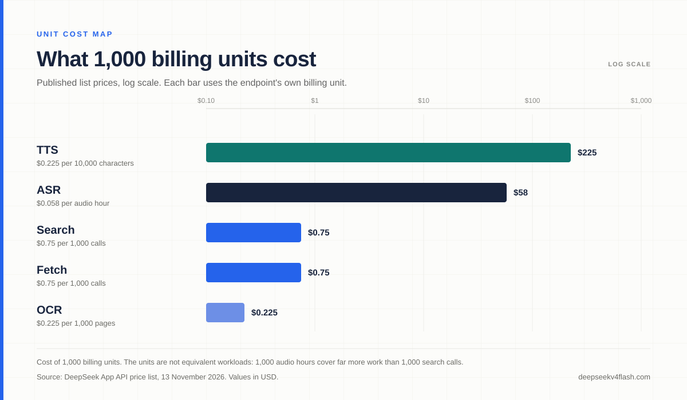
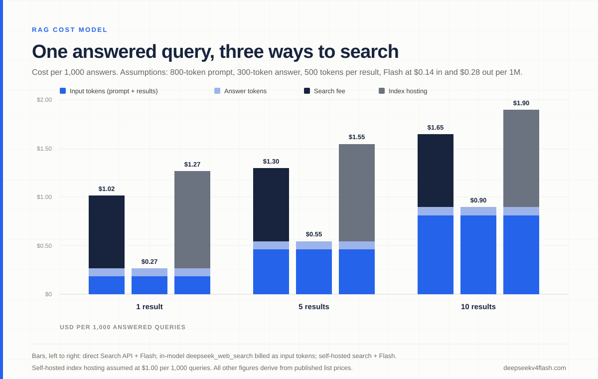
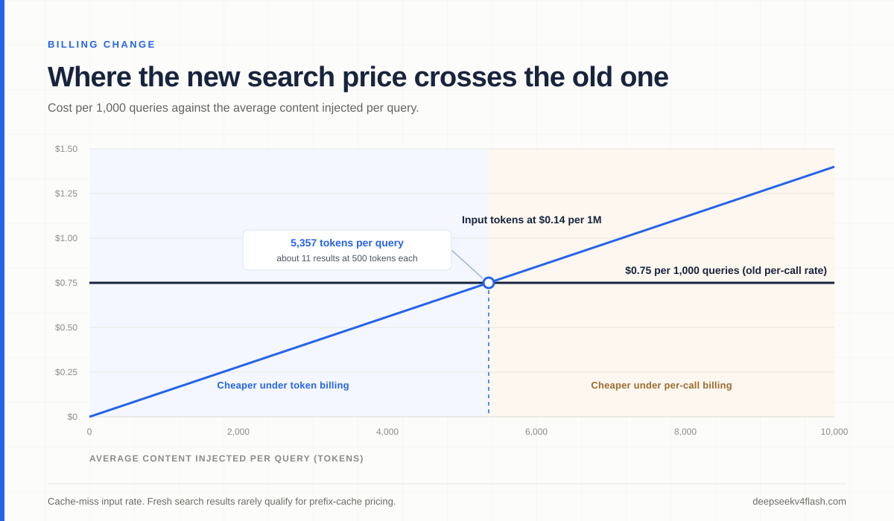

# DeepSeek 搜索 API 计费调整：这不只是降价

- 摘要：11 月 13 日，DeepSeek 把 App 里的能力开放成了 API；月底又把 server-side search 从按次收费改成按输入 token 计费。这篇写清楚每个计费单位的价格、一次 RAG 回答在三种架构下的成本，以及新旧搜索价格在哪里相交。
- 日期：2026-11-26
- 署名：By Cameron Voss
- 路由：/articles/deepseek-app-api-suite-unit-costs（仅预览，尚未登记到 src/lib）
- 语言：zh（英文对照见 article.md）
- 预览：preview/deepseek-app-api-suite-unit-costs.zh.html

## TL;DR

- 11 月 13 日，DeepSeek 把 App 的能力开放成 API：Search、Fetch、OCR、ASR、TTS、文件输入和安全校验。
- 牌面价格：Search 与 Fetch 每千次 $0.75，OCR 每千页 $0.225，ASR 每小时 $0.058，TTS 每万字符 $0.225。
- 11 月底起，server-side search 从按次收费改为按输入 token 计费。一条 500 token 的结果约 $0.00007，接近原来单次搜索费的十分之一。
- 新旧价格在每次查询约 5,400 token 处相交，按每条结果 500 token 算，大约是 11 条结果。
- 按一套明确假设计算，模型内搜索每千次回答 $0.27 到 $0.90；单独调 Search API 是 $1.02 到 $1.65。

## 正文

11 月 13 日，DeepSeek 把聊天 App 背后的能力开放成了 API。联网搜索、链接阅读、文件输入、安全校验、OCR、语音识别、语音合成，既可以单独调用，也可以作为模型请求里的开关打开。到了月底，server-side search 的计费方式也变了：从每次搜索固定收费，改成按搜索结果占用的输入 token 收费。

这两件事都不难描述。第二件很容易被理解成降价，其实不是。变的是计量对象，账单会往两个方向走，取决于搜索带回来多少文字。

### 五种能力，五种计价单位

价目表很短。Search 每千次 $0.75；Fetch 读取一个 URL 并返回内容，价格相同。OCR 和文件解析每千页 $0.225。语音识别每小时 $0.058。语音合成每万字符 $0.225。

先要注意的是单位。只有 Search 和 Fetch 按次计价，OCR 按页，ASR 按小时，TTS 按字符块。不换算就直接比大小，预算很容易算错。

*对数轴把 1,000 倍的价差放进一张图：最低 $0.225，最高 $225。*

换算成 1,000 个计费单位，最低是 1,000 页 OCR 的 $0.225，最高是 1,000 块 TTS 的 $225。Search 和 Fetch 在 $0.75。语音接口单看很便宜，一旦按小时和字符数跑量，就会变成账单上的大项：1,000 小时音频是 $58，一个月合成 100 万字符是 $22.50。单看都不吓人，出现在发票上时又很容易被忽略。

### 一次检索回答要花多少钱

单价说明不了一次 RAG 回答的成本。我按一组假设搭了一个单次查询的小模型：800 token 的提示词、300 token 的回答、每条搜索结果 500 token，Flash 输入每百万 token $0.14、输出 $0.28。自建搜索再加每千次查询 $1 的索引托管成本。最后这个数字是规划假设，不是厂商报价。

*每千次回答的成本。搜索费固定，token 成本随结果条数增长。*

每千次回答，模型内搜索一条结果 $0.27，五条 $0.55，十条 $0.90。单独调 Search API 再把结果交给 Flash，分别是 $1.02、$1.30、$1.65。差额就是搜索费：每千次 $0.75，不随结果条数变化，所以在短回答里占比更高，在长回答里占比更低。

按假设的托管成本，自建搜索是 $1.27、$1.55、$1.90，在这个量级下最贵。这个比较故意留了缺口：它只算单次查询的边际成本，没算建索引的固定成本，也没算你的索引和网页级索引之间的质量差距。自建可以在控制权、隐私或垂直语料上赢，很少在第一张账单上赢。

### 11 月底的交叉点

旧规则下，一次 server-side search 每千次查询 $0.75，不管返回多少文字。新规则下，同样的搜索按结果占用的输入 token 计费。按 $0.14 的 cache-miss 价格，两个价格在每次查询约 5,400 token 处相交。

*旧的按次计费是一条水平线，token 计费随注入内容增长。两者在每次查询约 5,400 token 处相交。*

按每条结果 500 token 算，大约是 11 条。低于这条线，按 token 更便宜。1,500 token 时，每千次查询约 $0.21，比原来的 $0.75 低 72%。高于这条线，原来的按次价格反而更便宜。10,000 token 时，新账单是每千次 $1.40，接近旧价格的两倍。

按 cache-hit 价格算，交叉点会推到 26,000 token 以上，但刚抓回来的搜索结果很少能命中前缀缓存。做预算时用 cache-miss 价格更稳妥。

规律很简单：浅搜索变便宜，深检索变贵。如果提示词里已经写死了结果条数上限，新计费大概率对你有利。如果由模型自己决定读多少页，就把 token 数和搜索次数放进同一个看板。

### 把价目表变成预算

估算主要靠日志里的三个数：每次回答触发多少次工具调用、每次调用注入多少 token、有多少请求真的会搜索。用上面的单价乘一遍，得到的就是预算，不是示例。

- 给每次搜索设结果上限。十条是产品决定，也是计价决定。
- 同一个 URL 抓两次就缓存。在三种架构里，这块钱都可以省。
- 看每次查询的 token 数，不要只看搜索次数。计费切换之后，长度才是让账单变化的变量。
- 把 OCR 和 ASR 单独列账。它们单价低，跑量时最容易被忘掉。

这套 API 的方便之处是一家供应商覆盖搜索、阅读、文档和语音。代价是账单上有五个不同的表，每个表变动的原因都不一样。token 表跟着输出长度走，页数和小时表跟着输入量走，搜索表现在跟着返回内容的长度走。

如果你想把这些单价和本站的套餐放在一起看，定价页列出了当前的额度和每个套餐包含的内容：https://deepseekv4flash.com/pricing

做初步估算，上面的数字够用。做真实预算，把我假设的 500 token 结果和 300 token 回答换成你自己的。单价是公开的，负载只有你能测。
