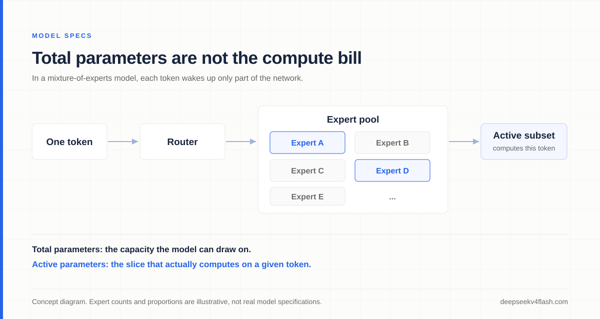
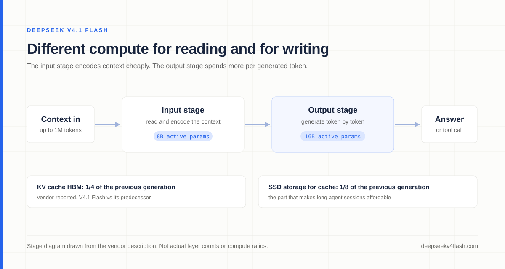
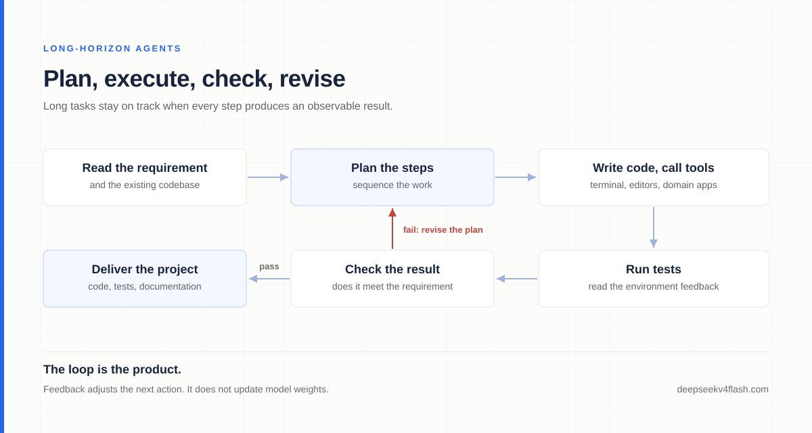
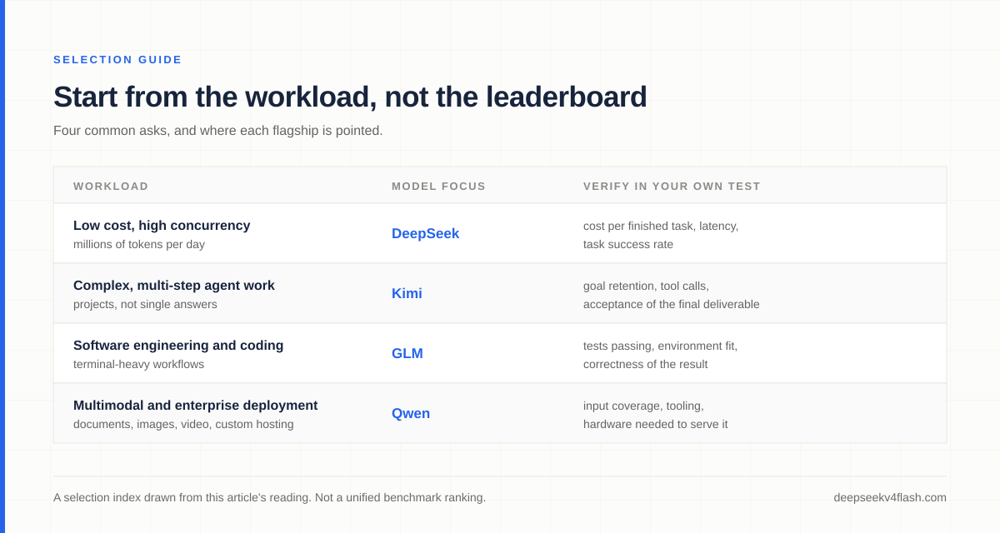

# DeepSeek, Kimi, GLM, and Qwen All Ship 1M Context. The Contest Is Now the Bill per Finished Task.

- Summary: DeepSeek V4.1 Flash, Kimi K3.1 Pro, GLM-5.3 and Qwen3.8-Max all ship 1M-token context. The real differences are in what each vendor optimised: cost per token, long-horizon agents, engineering execution or a multimodal platform.
- Date: 2026-11-21
- Byline: By Cameron Voss
- Route: /articles/deepseek-kimi-glm-qwen-flagship-comparison (registered in src/lib/november-articles.ts, November 21, 2026)
- Language: en (Chinese twin in article.zh.md)
- Preview: preview/deepseek-kimi-glm-qwen-flagship-comparison.en.html

## TL;DR

- DeepSeek V4.1 Flash, Kimi K3.1 Pro, GLM-5.3 and Qwen3.8-Max all carry 1M-token context. Context stopped being a differentiator.
- DeepSeek optimises cost per token: 552B total parameters, 8B active on input, 16B on output, KV cache cut to a quarter of the previous generation.
- Kimi optimises long-horizon work: 65.7% on Terminal-Bench 4.0, priced at $2 in and $10 out per million tokens.
- GLM-5.3 took its gains from post-training on the same base as 5.2; the Flash sibling cuts attention compute about 3x.
- Qwen3.8-Max pairs a 2.4T open-weight MoE with image and video understanding aimed at enterprise workflows.
- None of the published numbers share test conditions. Read them as direction, not as a leaderboard.

## Body

The spec war between Chinese labs has settled into a shared floor: trillion-parameter-class bodies, million-token context windows, agent-grade tool calling. What separates the fall 2026 flagships is no longer on the spec sheet. It is in what each vendor spent its training and engineering budget on.

I went through the four models the labs are actually pushing right now: DeepSeek V4.1 Flash (updated October 17), Kimi K3.1 Pro (released October 23), Zhipu's GLM-5.3 and Alibaba's Qwen3.8-Max. Here is what each one is good at, what the vendors claim, and where I would push back.

### The shared spec sheet

| Model | Total parameters | Active parameters | Context |
| --- | --- | --- | --- |
| DeepSeek V4.1 Flash | 552B | 8B on input, 16B on output | 1M |
| Kimi K3.1 Pro | 3T class | Not disclosed | 1M |
| GLM-5.3 | Not disclosed | Not disclosed | 1M |
| Qwen3.8-Max | 2.4T | About 95B | 1M |

Two things are worth understanding before quoting any of these numbers. First, total parameters are not the compute bill. These are mixture-of-experts models: each token passes a router and wakes up only a slice of the experts. Qwen3.8-Max carries 2.4T parameters and activates roughly 95B per token. DeepSeek goes further with an asymmetric split, 8B active while reading input and 16B while generating output.

*Total parameters describe capacity. Active parameters describe what a single token actually costs.*

Second, a 1M-token context window is a capacity claim, not a performance claim. What matters in production is whether the model still finds the clause on page 400, keeps the original goal in mind at step 80 of a task, and connects facts across two documents. Context length tells you the size of the desk, not how organised the worker is.

### DeepSeek V4.1 Flash: built around the cost of intelligence

If I had to summarise DeepSeek's strategy in one word it would be efficiency. V4.1 Flash does not chase the biggest body in the room. It uses an asymmetric encoder-decoder design where reading and writing get different compute budgets, because they are genuinely different jobs. Encoding a long context is parallel work. Generating output is sequential, token-by-token work. Giving both stages the same active parameter count wastes one of them.

*Reading and writing get separate compute budgets. The cache reductions are what long agent sessions feel.*

The other half of the story is memory. Agent sessions accumulate history across many tool calls, and that history lives in the KV cache. DeepSeek reports V4.1 Flash needs a quarter of the previous generation's HBM for that cache and an eighth of the SSD storage. For teams running long sessions, that is the difference between a cache that fits in memory and one that spills.

The October 17 update targeted agent work specifically: 77.0 on DeepSWE v1.1, 42.3 on Terminal-Bench 4.0, 68.2 on NL2Repo-Bench and 60.5 on Automation-Bench. The vendor also claims the update cut task runtime and output tokens at the same time, which is the claim I care about most. Better scores are common. Smaller bills per finished task are not.

This is the model to shortlist when the workload is high-concurrency: code analysis at scale, long-document processing, agent tool calling, any product where the API invoice is a line in your unit economics. If per-token economics drive your stack, our pricing page lists the current plans and their usage allowances, so you can cost a real workload before committing. (Internal link: https://deepseekv4flash.com/pricing)

### Kimi K3.1 Pro: built around the whole task

Kimi is asking a different question. Not "how cheaply can we answer" but "can the model finish the job". K3.1 Pro is a post-trained version of K3 with a heavier reinforcement-learning pass, aimed at code, 3D creation, financial research and long-horizon agent tasks.

*The loop is the product. Feedback changes the next action, not the model weights.*

The published numbers: 65.7% on Terminal-Bench 4.0. 61.2% on Kimi's internal Code Bench 3.0 long-horizon suite, up from 55.95% for K3. 92.7% on BenchCAD with tools, where the model rebuilds a 3D model as CAD code from multi-view renders. 64.4 on OfficeQA Pro v2, a test of retrieval and multi-step numeric reasoning over real financial documents.

Two caveats before you build on those. Some of the scores come from Kimi's own evaluations rather than independent runs. And the API is priced at $2 per million input tokens and $10 per million output, which puts it in a different cost tier from DeepSeek Flash. You are paying for completion, not for tokens. The full weights followed in early November, published under a custom Kimi K3.1 Pro License. It is a separate agreement, not MIT or Apache 2.0, so read the current terms before planning self-hosting or redistribution.

Where it fits: work that has stages and a deliverable. A model that reads the repo, writes a plan, edits code, runs tests and fixes its own failures. That loop, not the raw coding score, is what K3.1 Pro is selling.

### GLM-5.3: built around the engineering loop

Zhipu's interesting claim is not a score, it is a method. GLM-5.3 shares its base model with GLM-5.2. The gains come from post-training: reinforcement learning inside automatically generated task environments built from real engineering problems, with tests deciding whether the model actually finished the work. On the vendor's internal Z.ai Code Bench, coding performance is up 50% over 5.2. On DeepSWE v1.1 the score moved from 46.2 to 66.9.

That is a useful data point for anyone planning a model roadmap. A meaningful jump without a new pretraining run.

The Flash sibling, GLM-5.3-Flash, covers the cost-sensitive side: 320B total parameters, 18B active, mixing sparse attention for wide retrieval with linear attention for cheap local dependencies. Zhipu reports about 3x less attention compute and about 4.4x less KV cache than GLM-5.3, plus native image, video and file input. Flagship for depth, Flash for throughput. It is a clean two-product layout.

### Qwen3.8-Max: built around the platform

Alibaba is playing the widest hand. Qwen3.8-Max is a 2.4T-parameter MoE with hybrid attention, taking text, image and video input, with function calling and multi-tool orchestration aimed at real workflows rather than chat.

The demonstration the vendor keeps repeating is a 16-day run in which the model built a self-evolving agent framework from scratch: generating code, testing, previewing, reading its own logs, iterating, and eventually publishing the result as an open-source project. One internal case study is not a guarantee that your task runs for 16 days. Treat it as a statement of direction.

The more concrete point is the weights. The 2.4T Qwen3.8 weights are open and deployable through vLLM or SGLang. Open at that size does not mean laptop-friendly: serving it takes multi-node accelerated compute. The value of open weights here is control, meaning your infrastructure, your optimisations, your fine-tunes.

### Picking by workload

Put the four side by side and it becomes clear they are not competing on the same axis.

| Dimension | DeepSeek | Kimi | GLM | Qwen |
| --- | --- | --- | --- | --- |
| Core strength | Inference efficiency, cost | Long-horizon agents | Engineering and coding | Multimodal and ecosystem |
| Multimodal | Vision | Vision plus 3D workflows | Native on Flash | Image and video |
| Context | 1M | 1M | 1M | 1M |
| Cost posture | Low cost | Capability first | Low cost on Flash | Tiered product line |

- **Cost-sensitive, high-concurrency serving:** DeepSeek. The bill per finished task is the product.
- **Multi-stage projects with a deliverable:** Kimi. Goal retention across many tool calls is what you are buying.
- **Terminal-heavy software engineering:** GLM. The training environments were built around exactly this loop.
- **Multimodal input and self-hosted enterprise deployment:** Qwen. Open weights plus image and video coverage.

*Start from the workload. The model follows.*

One warning about everything above. These numbers do not share test conditions. Different model versions, reasoning settings, tool scaffolds and harnesses sit behind them. A table like this is a map of where to start testing, not a ranking of who won.

### The competition moved

Two years ago the contest was parameter counts and benchmark scores. The fall 2026 flagships compete on post-training, task environments, inference memory and cost per finished task. The labs are no longer selling a smarter answer. They are selling finished work: the report, the repository, the model file, the pipeline that runs without a human in the loop.

That shift changes how to choose. The best model is not the one that wins the most rows in a table. It is the one whose bet matches your workload, verified on your own tasks, at a cost your unit economics can carry.
