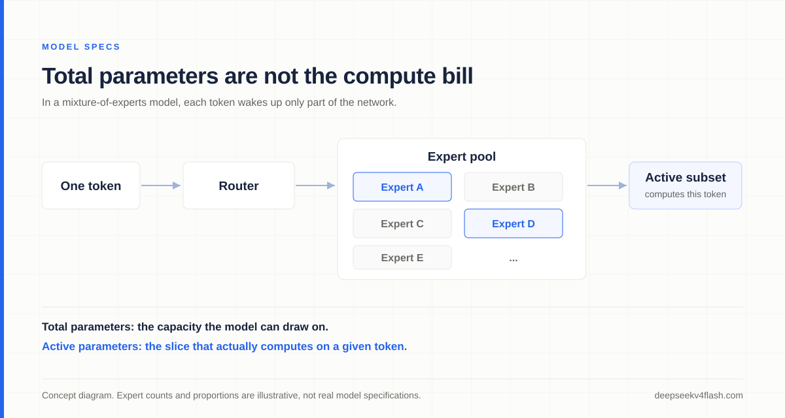
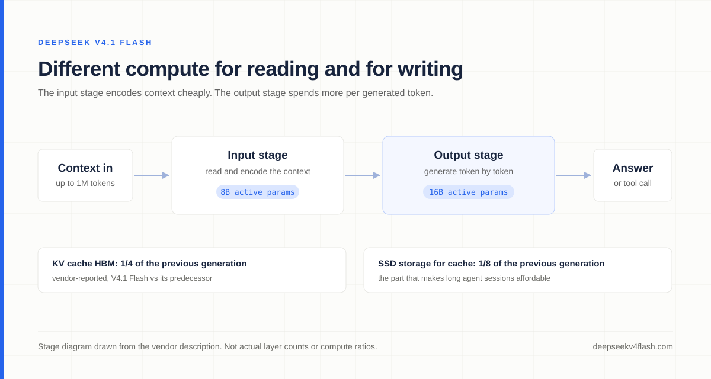
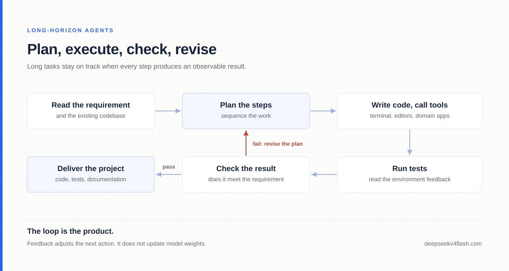
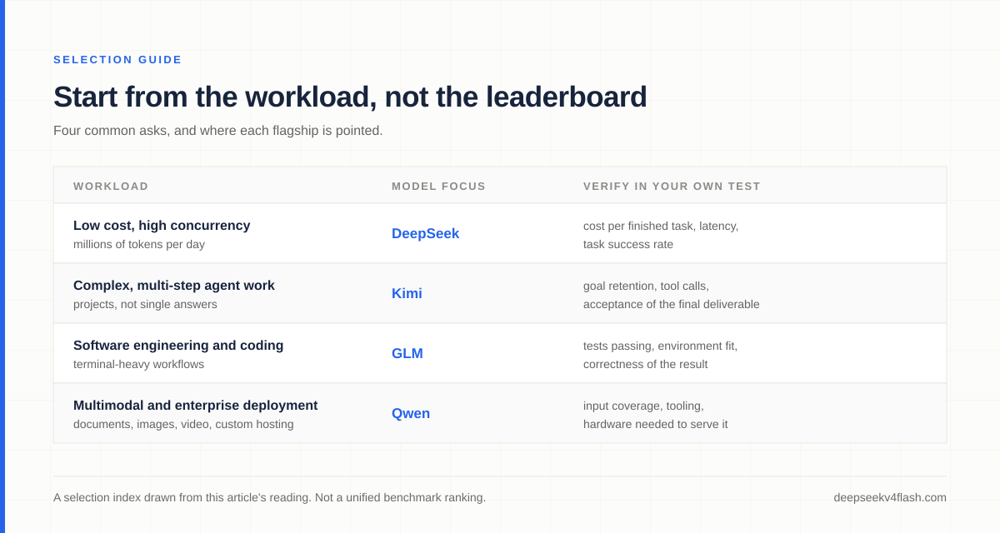

# DeepSeek、Kimi、GLM、Qwen 都给到了 1M 上下文，现在较劲的是“每完成一个任务要付多少”。

- 摘要：DeepSeek V4.1 Flash、Kimi K3.1 Pro、GLM-5.3、Qwen3.8-Max 都把上下文做到了 1M。真正的差异在别处：单 Token 成本、长程 Agent、工程执行、多模态平台。
- 日期：2026-11-21
- 署名：By Cameron Voss
- 路由：/articles/deepseek-kimi-glm-qwen-flagship-comparison（已登记到 src/lib/november-articles.ts，2026-11-21）
- 语言：zh（英文对照见 article.md）
- 预览：preview/deepseek-kimi-glm-qwen-flagship-comparison.zh.html

## TL;DR

- DeepSeek V4.1 Flash、Kimi K3.1 Pro、GLM-5.3、Qwen3.8-Max 全部支持 1M 上下文，上下文已经不再是差异点。
- DeepSeek 赌的是单 Token 成本：总参 552B，输入激活 8B、输出激活 16B，KV Cache 降到上一代的四分之一。
- Kimi 赌的是长程任务：Terminal-Bench 4.0 拿到 65.7%，API 定价每百万 Token 输入 2 美元、输出 10 美元。
- GLM-5.3 的提升来自后训练，基础模型与 5.2 相同；Flash 版本的注意力计算量约降为三分之一。
- Qwen3.8-Max 是 2.4T 开放权重 MoE，配上图像和视频理解，面向企业工作流。
- 各家公开成绩的测试条件并不统一，适合当作选型方向，不适合当作排行榜。

## 正文

国产大模型的参数竞赛已经卷到了一个共同的下限：万亿级参数、百万级上下文、Agent 级工具调用。2026 年秋季这几款旗舰模型之间的差距，已经不在参数表上了，而在每家厂商把训练和工程预算花在了哪里。

我把四家当前主推的模型过了一遍：DeepSeek V4.1 Flash（10 月 17 日更新）、Kimi K3.1 Pro（10 月 23 日发布）、智谱 GLM-5.3、阿里 Qwen3.8-Max。下面写清楚每家擅长什么、厂商自己怎么说、以及哪些地方需要打个折扣。

### 先看大家都一样的部分

| 模型 | 总参数量 | 激活参数量 | 上下文 |
| --- | --- | --- | --- |
| DeepSeek V4.1 Flash | 552B | 输入 8B、输出 16B | 1M |
| Kimi K3.1 Pro | 3T 级 | 未披露 | 1M |
| GLM-5.3 | 未披露 | 未披露 | 1M |
| Qwen3.8-Max | 2.4T | 约 95B | 1M |

引用这些数字之前，有两件事要先弄明白。第一，总参数量不等于计算账单。这几款都是 MoE 架构：每个 Token 经过路由，只唤醒一部分专家。Qwen3.8-Max 总参 2.4T，每个 Token 激活约 95B。DeepSeek 更进一步做了非对称设计，读输入时激活 8B，写输出时激活 16B。

*总参数描述的是容量，激活参数描述的是单个 Token 的真实成本。*

第二，1M 上下文是容量声明，不是能力声明。生产环境里真正重要的是：模型还能不能找到文档第 400 页的那个条款，能不能在任务第 80 步还记得最初的目标，能不能把两份文档里的事实关联起来。上下文长度告诉你桌子有多大，不告诉你做事的人条理如何。

### DeepSeek V4.1 Flash：围绕智能的成本做设计

如果用一个词概括 DeepSeek 的路线，是效率。V4.1 Flash 不追最大的体量，而是用非对称的 Encoder-Decoder 设计，让读和写拿不同的计算预算，因为这两件事本来就是不同的工作。编码长上下文是可以并行的工作，生成输出是逐 Token 的串行工作，给两个阶段配同样的激活参数，必然有一边在浪费。

*读和写分开配计算预算。缓存的下降，是长 Agent 会话最能直接感受到的部分。*

故事的另一半是显存。Agent 会话会在多轮工具调用中不断积累历史，这些历史放在 KV Cache 里。DeepSeek 官方披露，V4.1 Flash 的 KV Cache 所需 HBM 降到上一代的四分之一，SSD 存储降到八分之一。对跑长会话的团队来说，这就是缓存放得进显存和放不进去的区别。

10 月 17 日的更新专门针对 Agent 任务：DeepSWE v1.1 拿到 77.0，Terminal-Bench 4.0 拿到 42.3，NL2Repo-Bench 68.2，Automation-Bench 60.5。官方同时强调，这次更新在提升成绩的同时还降低了任务运行时间和输出 Token 数。这一条比跑分更值得看：成绩提升常见，单个任务的账单变小不常见。

如果你的负载是高并发场景，比如大规模代码分析、长文档处理、Agent 工具调用，API 账单直接写进单位成本，那么这款应该进短名单。如果单 Token 成本是你的核心约束，我们的定价页列出了当前套餐和用量额度，可以先按真实负载算一笔账再决定。（站内链接：https://deepseekv4flash.com/pricing）

### Kimi K3.1 Pro：围绕完整任务做设计

Kimi 问的是另一个问题：不是"回答得有多便宜"，而是"模型能不能把一件事做完"。K3.1 Pro 是 K3 的后训练版本，用了更大规模的强化学习，重点面向代码、3D 创作、金融研究和长程 Agent 任务。

*闭环本身才是产品。反馈改变的是下一步行动，不是模型权重。*

公开的成绩：Terminal-Bench 4.0 65.7%；Kimi 内部 Code Bench 3.0 长程套件 61.2%，上一代 K3 是 55.95%；BenchCAD 借助工具拿到 92.7%，考的是根据多视角渲染图生成 CAD 代码重建三维模型；OfficeQA Pro v2 64.4 分，考真实金融文档里的检索和多步数值推理。

有两个折扣要打在前面。一部分成绩来自 Kimi 自己的评测，不是独立第三方结果。API 定价每百万 Token 输入 2 美元、输出 10 美元，和 DeepSeek Flash 不在一个成本档位，你付的是"做完"，不是"Token"。完整权重已在 11 月上旬放出，用的是自定义的 Kimi K3.1 Pro License，是一份单独协议，不是 MIT 或 Apache 2.0；规划自托管或再分发之前，先读一遍当前条款。

适合的场景是有阶段、有交付物的工作：读仓库、写方案、改代码、跑测试、自己修失败。K3.1 Pro 卖的是这个闭环，不是单项编码跑分。

### GLM-5.3：围绕工程闭环做设计

智谱最有意思的声明不是分数，是方法。GLM-5.3 与 GLM-5.2 共用同一个基础模型，提升来自后训练：从真实工程任务自动生成可运行的任务环境，在里面做强化学习，用测试判定模型是否真的完成了工作。官方披露，内部 Z.ai Code Bench 上编码表现比 5.2 提升 50%，DeepSWE v1.1 从 46.2 提升到 66.9。

对在做模型路线规划的人来说，这是一个有用的数据点：不做新的大规模预训练，也能拿到明显的提升。

Flash 版本 GLM-5.3-Flash 负责成本敏感的一侧：总参 320B、激活 18B，稀疏注意力负责大范围检索，线性注意力负责低成本的局部依赖。智谱披露注意力计算量约为 GLM-5.3 的三分之一，KV Cache 约降 4.4 倍，并原生支持图像、视频和文件输入。旗舰管深度，Flash 管吞吐，产品布局很清楚。

### Qwen3.8-Max：围绕平台做设计

阿里的手牌最宽。Qwen3.8-Max 是 2.4T 参数的 MoE，混合注意力，支持文本、图像、视频输入，配 Function Calling 和多工具协同，目标不是聊天，是真实工作流。

厂商反复讲的一个案例是连续 16 天的软件工程运行：模型从零构建一个自进化 Agent 框架，生成代码、测试、预览、读自己的日志、迭代优化，最后把成果发布成开源项目。一个内部案例不等于你的任务也能稳定跑 16 天，把它当作方向声明更合适。

更实在的一点是权重。2.4T 的 Qwen3.8 权重开放，可以用 vLLM、SGLang 部署。这个体量的"开放"不等于个人电脑能跑，真正服务化需要多节点加速计算。开放权重的价值在于控制权：自己的基础设施、自己的推理优化、自己的微调。

### 按任务选型

把四家放在一起看，会发现它们并不在同一条轴上竞争。

| 维度 | DeepSeek | Kimi | GLM | Qwen |
| --- | --- | --- | --- | --- |
| 核心优势 | 推理效率、性价比 | 长程 Agent | 工程与 Coding | 多模态与生态 |
| 多模态 | 视觉 | 视觉加 3D 工作流 | Flash 原生支持 | 图像、视频 |
| 上下文 | 1M | 1M | 1M | 1M |
| 成本策略 | 低成本 | 能力优先 | Flash 低成本 | 多层产品布局 |

- **成本敏感、高并发服务：** 选 DeepSeek。你买的是单个完成任务的账单。
- **多阶段、有交付物的项目：** 选 Kimi。你买的是大量工具调用之下的目标保持能力。
- **终端密集的软件工程：** 选 GLM。它的训练环境就是围绕这个闭环搭的。
- **多模态输入与企业自托管：** 选 Qwen。开放权重加上图像和视频覆盖。

*从任务出发，模型跟着任务走。*

上面所有内容都要带一个前提：这些数字的测试条件并不统一，背后的模型版本、推理强度、工具框架和评测环境各不相同。这样的表格是"从哪里开始测"的地图，不是"谁赢了"的排名。

### 竞争已经换了一个赛道

两年前比的是参数量和 Benchmark 跑分。2026 年秋季的旗舰模型比的是后训练、任务环境、推理内存和单个完成任务的成本。厂商卖的不再是一个更聪明的回答，而是做完的工作：那份报告、那个仓库、那个模型文件、那条不需要人盯着的流程。

这个变化也改变了选型方式。最好的模型不是表格里赢下最多行的那一个，而是路线和你的任务匹配、在你自己的任务上验证过、成本在你的单位经济里站得住的那一个。
